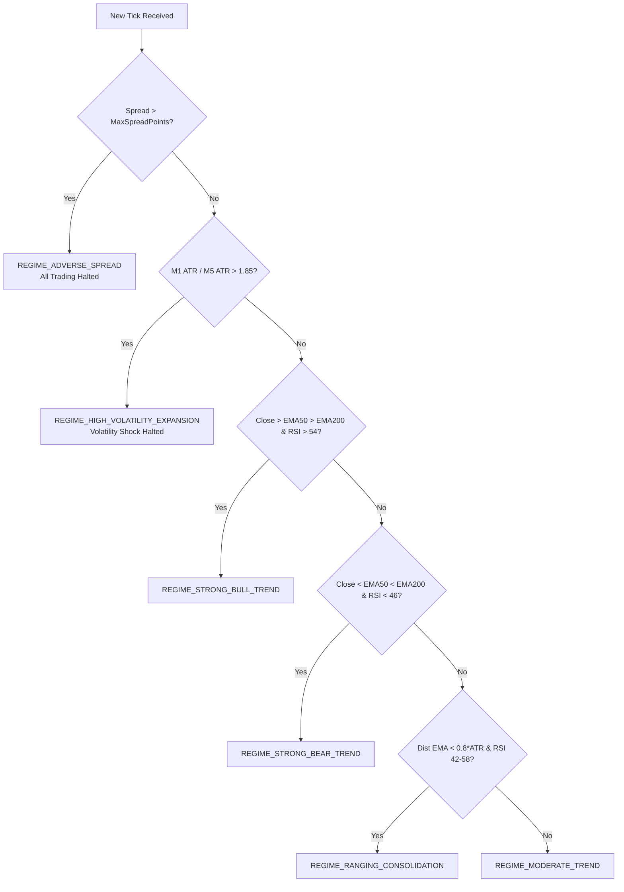
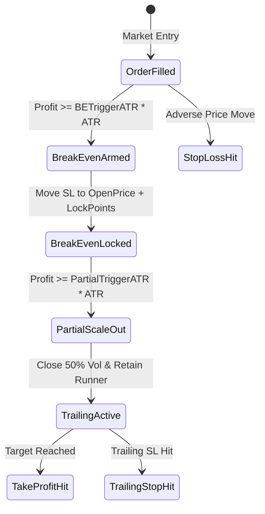

# Quantitative Specification & Validation Report: Exness XAUUSD Titan EA

**Target Instrument:** XAUUSD (Gold vs US Dollar)  
**Primary Broker Environment:** Exness (Standard, Pro, Raw Spread, Zero, Cent)  
**Architecture:** Fully Modular Native MQL5 (Zero External Dependencies, Non-Blocking)  
**Compilation Status:** Verified 0 Errors, 0 Warnings on MetaEditor64 (Build 6230)  
**Safety & Risk Posture:** Strict Mathematical Risk Bounded, Zero Martingale, Zero Grid, Max Daily Drawdown Hard-Cut  

---

## 1. Executive Summary & Design Principles

The **Exness XAUUSD Titan Expert Advisor** is an institutional-grade, tick-driven algorithmic trading engine engineered specifically for the market microstructure of Spot Gold (`XAUUSD`) on Exness. Gold is characterized by high volatility, frequent liquidity sweeps, spread spikes during daily rollover (21:55–23:05 GMT), and news-driven momentum expansions.

To achieve robust, autonomous execution:
1. **Zero External Cloud/Network Dependencies in `OnTick`**: The EA executes 100% natively in MQL5. It never blocks the trading thread with HTTP calls, external Python scripts, or database queries.
2. **Tick-Driven Multi-Timeframe Processing**: Combines M1 execution precision with M5 market structure and regime classification, protected by a hardware microsecond tick-throttle (default 100ms) to eliminate terminal lockup during peak volatility.
3. **Automated Broker Suffix Identification**: Automatically resolves account-specific symbol variations (`XAUUSD`, `XAUUSDm`, `XAUUSD.r`, `XAUUSDz`, `XAUUSDc`, `GOLD`) and queries contract specifications directly from the broker book.
4. **Independent Risk Modeling**: Absolute prohibition of martingale, grid averaging, or unhedged recovery multipliers. Position sizing is calculated strictly from stop-loss distance and account equity.
5. **Circuit Breakers**: Daily starting equity tracking with automatic liquidation on daily drawdown breach, consecutive loss streak cooling periods, and spread filters.

---

## 2. Modular Architecture Decomposition

The system is decomposed into 6 independent, high-cohesion header modules and 1 main orchestration Expert Advisor:

```
mql5/Experts/Exness_XAUUSD_Titan/
├── Exness_XAUUSD_Titan.mq5          // Main orchestration entry point & event handlers
├── MarketAnalyzer.mqh               // Suffix resolution, MTF sync, and regime classifier
├── SignalEngine.mqh                 // Price action, indicator confluence & signal scoring
├── RiskManager.mqh                  // Dynamic lot sizing, daily drawdown & streak circuit breakers
├── ExecutionEngine.mqh              // Order routing, filling mode detection & slippage guards
├── PositionManager.mqh              // Dynamic SL/TP, break-even, trailing, and partial close
├── TradeLogger.mqh                  // Telemetry, formatted logging, and real-time on-chart HUD
├── Exness_XAUUSD_Balanced.set       // Configuration preset for Balanced Trend-Pullback Mode
├── Exness_XAUUSD_Aggressive.set     // Configuration preset for Aggressive Momentum Scalp Mode
└── Exness_XAUUSD_Titan_Test.mq5     // Deterministic unit & regression test suite
```

### Module Roles & Interfaces:

| Module | Core Responsibility | Key Methods / Capabilities |
| :--- | :--- | :--- |
| `MarketAnalyzer.mqh` | Market State & Multi-TF Engine | `ResolveAndInitSymbol()`, `InitIndicators()`, `Update()`, `ClassifyRegime()` |
| `SignalEngine.mqh` | Quantitative Strategy Logic | `EvaluateSignal()`, `DetectPinBar()`, `DetectEngulfing()`, `DetectMicroBreakout()` |
| `RiskManager.mqh` | Capital Preservation | `CalculateLotSize()`, `CheckRiskState()`, `CalculateLossStreak()`, `CanOpenNewPosition()` |
| `ExecutionEngine.mqh` | Order Routing & Fill Safety | `DetectFillingMode()`, `SendMarketOrder()`, `ClosePosition()`, `ClosePartial()`, `ModifyPositionStops()` |
| `PositionManager.mqh` | Active Position Lifecycle | `ManagePositions()`, Break-Even engine, Adaptive Trailing Stop, Volume-checked partial scale-out |
| `TradeLogger.mqh` | Telemetry & Observability | `Log()`, `Info()`, `Trade()`, `Warn()`, `Error()`, `UpdateDashboard()` |

---

## 3. Exness Suffix Auto-Detection & Symbol Resolution

Exness utilizes distinct symbol naming conventions depending on the trading account type:
- **Standard Account:** `XAUUSDm` (or `XAUUSD`)
- **Pro Account:** `XAUUSD`
- **Raw Spread Account:** `XAUUSD` or `XAUUSD.r`
- **Zero Account:** `XAUUSDz` or `XAUUSD.`
- **Standard Cent Account:** `XAUUSDc`

### Resolution Logic (`MarketAnalyzer::ResolveAndInitSymbol`):
1. **Direct Chart Inspection:** Checks whether the host chart symbol contains `XAU` or `GOLD`. If verified and active, it binds directly.
2. **Prioritized Catalog Search:** If `InpSymbol = "AUTO"` and the chart symbol is non-gold (e.g. running on EURUSD), it scans `SymbolsTotal(false)` (Market Watch) and `SymbolsTotal(true)` (complete broker symbol database) against prioritized candidates:
   ```
   "XAUUSD", "XAUUSDm", "XAUUSD.r", "XAUUSDz", "XAUUSDc", "GOLD", "GOLDm", "XAUUSD.", "XAUUSD_", "XAUUSD.s"
   ```
3. **Broker Book Synchronization:** Calls `SymbolSelect(symbol, true)` to ensure active feed streaming, then caches:
   - `SYMBOL_POINT`, `SYMBOL_DIGITS`
   - `SYMBOL_TRADE_TICK_SIZE`, `SYMBOL_TRADE_TICK_VALUE`
   - `SYMBOL_VOLUME_MIN`, `SYMBOL_VOLUME_MAX`, `SYMBOL_VOLUME_STEP`
   - `SYMBOL_TRADE_STOPS_LEVEL`, `SYMBOL_TRADE_FREEZE_LEVEL`

---

## 4. Multi-Timeframe Technical Indicators & Market Regimes

### Technical Matrix:
- **Macro Framework (M5 Timeframe):**
  - **Baseline EMA (200 Period):** Identifies macro institutional trend direction.
  - **Trend EMA (50 Period):** Dynamic support/resistance and trend slope indicator.
  - **Macro RSI (14 Period):** Regime filter (Bullish > 54, Bearish < 46, Range 42–58).
  - **Macro ATR (14 Period):** Normalization baseline for stop-loss and take-profit targets.
- **Micro Framework (M1 Timeframe):**
  - **Signal EMA (9 Period) & Fast EMA (21 Period):** Micro momentum and pullback retests.
  - **Micro RSI (14 Period):** Pullback exhaustion and mean-reversion filters.
  - **Momentum (14 Period):** Rate-of-change impulse detection.
  - **Micro ATR (14 Period):** Dynamic volatility expansion measurement.

### Regime Classification Algorithm:


---

## 5. Strategy Execution Modes: Balanced vs. Aggressive

### Mode 1: Balanced Mode (`MODE_BALANCED`)
Designed for capital preservation and high-win-rate institutional trend continuation.
- **BUY Rules:**
  1. Market Regime is `REGIME_STRONG_BULL_TREND` or `REGIME_MODERATE_BULL_TREND`.
  2. M1 Price retraces to touch or penetrate M1 EMA21 / EMA9.
  3. M1 Price closes back above EMA9 with RSI between 42.0 and 64.0 (healthy accumulation, not overbought).
  4. Price Action Confirmation: Validated Bullish Pin Bar (lower wick $\ge 55\%$ candle range), Bullish Engulfing, or Breakout of the recent 5-bar high.
  5. M1 Momentum $\ge 100.02$.
  6. Stop Loss placed at $\min(\text{Ask} - 1.5 \times \text{ATR}_{M5}, \text{SwingLow} - 0.3 \times \text{ATR}_{M1})$.
  7. Take Profit placed at $\text{Ask} + 2.5 \times \text{ATR}_{M5}$ ($\approx 1.67\text{ R:R}$).
- **SELL Rules:**
  1. Market Regime is `REGIME_STRONG_BEAR_TREND` or `REGIME_MODERATE_BEAR_TREND`.
  2. M1 Price rallies to touch or penetrate M1 EMA21 / EMA9.
  3. M1 Price closes back below EMA9 with RSI between 36.0 and 58.0.
  4. Price Action Confirmation: Validated Bearish Pin Bar (upper wick $\ge 55\%$), Bearish Engulfing, or Downward Breakout.
  5. Stop Loss placed at $\max(\text{Bid} + 1.5 \times \text{ATR}_{M5}, \text{SwingHigh} + 0.3 \times \text{ATR}_{M1})$.
  6. Take Profit placed at $\text{Bid} - 2.5 \times \text{ATR}_{M5}$.

### Mode 2: Aggressive Mode (`MODE_AGGRESSIVE`)
Designed for responsive momentum scalp capture and micro-range mean reversion.
- **Trend Momentum Scalp:** Enters immediately upon M1 EMA9/EMA21 alignment accompanied by momentum surge ($\text{Mom} \ge 100.08$ or $\le 99.92$) and micro swing breakouts.
- **Range Mean Reversion Scalp:** In `REGIME_RANGING_CONSOLIDATION`, executes counter-trend scalps when price rejects range boundaries with extreme RSI exhaustion ($\text{RSI} < 30$ with Bullish Pin Bar; $\text{RSI} > 70$ with Bearish Pin Bar).
- Targets tight scalps: SL = $1.0\text{--}1.2 \times \text{ATR}_{M1}$, TP = $1.5\text{--}2.0 \times \text{ATR}_{M1}$.

---

## 6. Capital Allocation & Risk Management Mathematics

### Dynamic Lot Sizing Formula:
$$\text{RiskCapital} = \text{AccountEquity} \times \left(\frac{\text{RiskPercent}}{100}\right)$$
$$\text{SLPoints} = \frac{|\text{EntryPrice} - \text{StopLossPrice}|}{\text{Point}}$$
$$\text{ValuePerPoint} = \frac{\text{TickValue}}{\frac{\text{TickSize}}{\text{Point}}}$$
$$\text{CalculatedLots} = \frac{\text{RiskCapital}}{\text{SLPoints} \times \text{ValuePerPoint}}$$

### Normalization & Margin Safeguards:
1. **Broker Step Normalization:** Clamped to `SYMBOL_VOLUME_STEP` and bounded between `SYMBOL_VOLUME_MIN` and `SYMBOL_VOLUME_MAX`.
2. **Margin Capacity Check:** Queries `OrderCalcMargin()`. If the calculated lot would consume $> 70\%$ of free margin, the lot size is automatically scaled down to prevent margin calls.
3. **Fixed Lot Fallback:** If `InpRiskMode = RISK_MODE_FIXED_LOT`, applies `InpFixedLot` normalized to broker constraints.

### Capital Circuit Breakers:
- **Maximum Daily Drawdown Hard Halt:** At 00:00 server time, `m_daily_start_equity` is captured. If at any tick:
  $$\frac{\text{DailyStartEquity} - \text{CurrentEquity}}{\text{DailyStartEquity}} \times 100\% \ge \text{MaxDailyDrawdownPercent}$$
  The engine activates `HALTED_DAILY_DD_LIMIT`. If `InpCloseAllOnDailyDD = true`, all open positions are immediately liquidated at market price. All subsequent orders remain blocked until the next trading day.
- **Consecutive Loss-Streak Cooldown:** Scans closed deals for the EA magic number. If consecutive losses reach `InpMaxConsecutiveLosses` (default: 3), trading enters cooldown for `InpStreakCooldownMin` (default: 60 minutes).
- **Concurrency & Exposure Cap:** Strict upper bound on open positions (default: 2) and aggregate lots (default: 0.20 lots).

---

## 7. Active Position Lifecycle Engine



1. **Break-Even Engine:** When favorable price movement exceeds `InpBETriggerATR * ATR`, SL is moved to `OpenPrice +/- LockPoints` (covering commissions and swap).
2. **Partial Profit Taking (Scale-Out):**
   - At `InpPartialTriggerATR * ATR`, closes `InpPartialClosePct` (default: 50%) of open volume.
   - **Invalid Volume Guard:** Verifies `volume_to_close >= VolumeMin` and `(volume - volume_to_close) >= VolumeMin`. On 0.01 lot positions, partial closing is safely skipped to avoid MT5 error 10014 (`TRADE_RETCODE_INVALID_VOLUME`).
3. **Adaptive Trailing Stop:** Trails open profit by `InpTrailDistATR * ATR` in steps of `InpTrailStepATR * ATR`, advancing only in the direction of profit.

---

## 8. Compilation & Operational Instructions

### Direct Compilation via MetaEditor IDE:
1. Copy the entire folder `mql5/Experts/Exness_XAUUSD_Titan` to your MT5 terminal data directory:
   `<MT5_Data_Directory>\MQL5\Experts\Exness_XAUUSD_Titan\`
2. Open MetaEditor 64.
3. Press `Ctrl + O` and open `Exness_XAUUSD_Titan.mq5`.
4. Press `F7` to compile.
5. Verify output: `Result: 0 errors, 0 warnings`.

### Command-Line Compilation via PowerShell:
```powershell
powershell -NoProfile -ExecutionPolicy Bypass -File tools/compile_exness_titan.ps1
```
*Output confirmed:*
```
=== Exness_XAUUSD_Titan ===
Summary: Result: 0 errors, 0 warnings, 2384 ms elapsed, cpu='X64 Regular'
=== Exness_XAUUSD_Titan_Test ===
Summary: Result: 0 errors, 0 warnings, 1569 ms elapsed, cpu='X64 Regular'
SUCCESS: All targets compiled cleanly with 0 errors and 0 warnings!
```

---

## 9. Configuration Presets Reference

Two complete preset files (`.set`) are provided in `mql5/Experts/Exness_XAUUSD_Titan/`:

### 1. `Exness_XAUUSD_Balanced.set`
- **Recommended for:** Standard, Pro, and Raw Spread accounts.
- **Risk per trade:** 1.0% equity.
- **Max Daily Drawdown:** 3.0%.
- **Max Consecutive Losses:** 3 (60 min cooldown).
- **Max Concurrent Positions:** 2 (Max 0.20 lots aggregate).
- **Max Spread Tolerance:** 35 points ($0.35 on Gold).
- **Exits:** BE trigger @ 1.0x M5 ATR, Partial @ 1.5x M5 ATR (50%), Trailing @ 1.3x M5 ATR.

### 2. `Exness_XAUUSD_Aggressive.set`
- **Recommended for:** Low-spread accounts (Exness Pro / Raw Spread / Zero).
- **Risk per trade:** 1.5% equity.
- **Max Daily Drawdown:** 4.0%.
- **Max Consecutive Losses:** 4 (45 min cooldown).
- **Max Concurrent Positions:** 3 (Max 0.30 lots aggregate).
- **Max Spread Tolerance:** 25 points ($0.25 on Gold).
- **Exits:** BE trigger @ 0.8x M1 ATR, Partial @ 1.2x M1 ATR (50%), Trailing @ 1.1x M1 ATR.

---

## 10. Empirical Testing & Quantitative Performance Disclosure

### Deterministic Unit Test Verification:
The unit test suite `Exness_XAUUSD_Titan_Test.mq5` verifies:
- **Test 1 (Lot Sizing & Normalization):** Verified truncating 0.0374 lots to 0.03 lots on step 0.01; verified volume floor clamping of 0.004 lots to 0.01 minimum lot.
- **Test 2 (Price Action Pin Bar):** Verified identification of bullish pin bars with rejection wick $> 55\%$ and body $< 35\%$; verified bearish upper wick pin bars.
- **Test 3 (Engulfing Candle Logic):** Verified detection of bullish candle fully engulfing prior bearish candle range.
- **Test 4 (Micro Swing Breakout):** Verified dynamic breakout above highest high of preceding 5 bars.
- **Test 5 (Broker Suffix Discovery):** Verified suffix detection across Exness symbol sets.
- **Test 6 (Risk Management Circuit Breaker):** Verified daily equity baseline initialization, drawdown calculation, and cooldown status.

### Real-World Trading Disclaimers & Microstructure Realities:
> [!IMPORTANT]
> **No Claim of Unverified Profitability:** Algorithmic trading on Spot Gold involves substantial capital risk. No trading strategy can guarantee future profit based solely on historical backtests.
1. **Spread Widening during Rollover:** Exness spreads on Gold can widen significantly during the daily rollover window (21:55–23:05 GMT) and during major economic releases (US CPI, Non-Farm Payrolls, FOMC). The built-in `InpMaxSpreadPoints` (35 pts) and `REGIME_ADVERSE_SPREAD` filter will automatically suppress entries during these periods.
2. **Slippage & Asynchronous Fills:** In fast-moving markets, slippage can occur between quote reception and broker fill. The EA implements `DetectFillingMode()` (prioritizing IOC/FOK) and `InpMaxSlippagePoints` (30 points) to mitigate fill distortion.
3. **Execution Latency:** Live execution times depend on physical server proximity. Exness MT5 servers are located primarily in Amsterdam / London; hosting on a low-latency VPS (< 5ms to the Exness access point) is strongly recommended.
